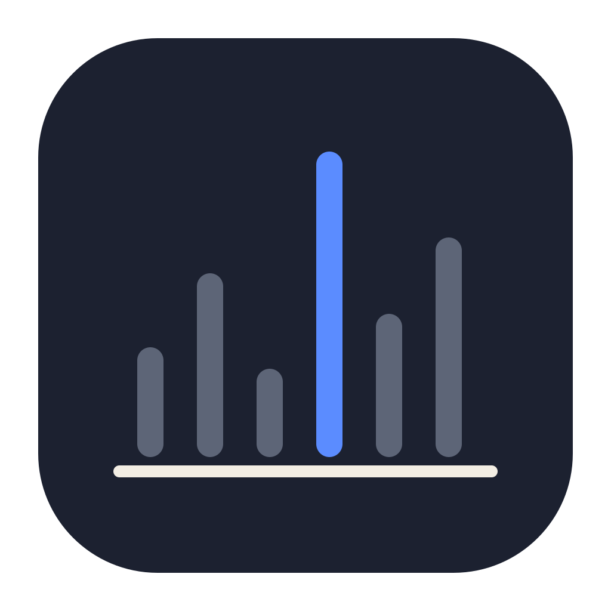
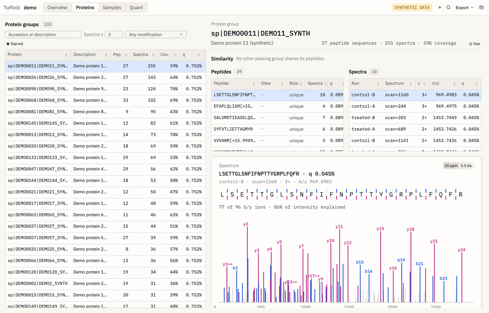
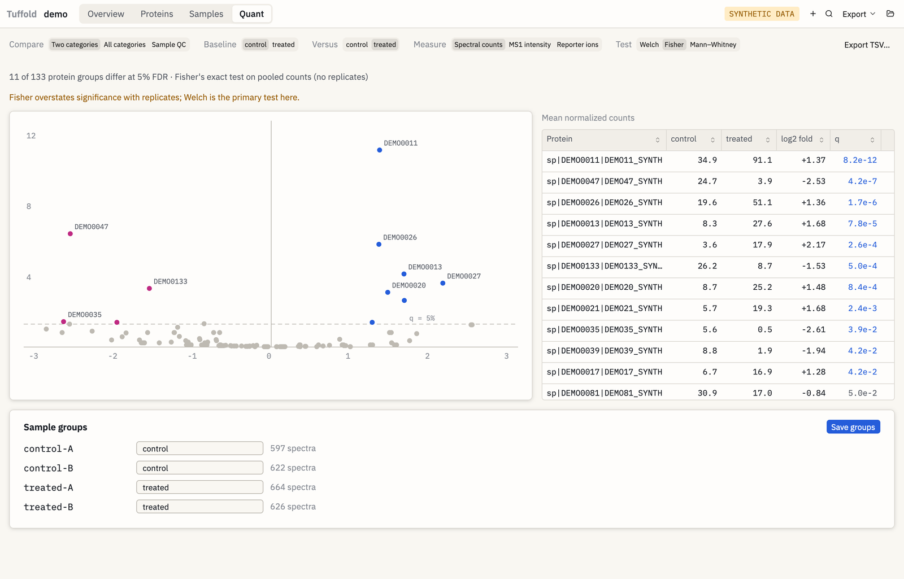

<p align="center">
  
</p>

<h1 align="center">Tuffold</h1>

<p align="center"><strong>Proteomics validation you can check.</strong></p>

<p align="center">
  FDR, protein inference, and quantitation for MS/MS results, in a native desktop app.<br>
  Free &middot; Open source &middot; Written in Rust
</p>

<p align="center">
  <a href="https://github.com/TUFF-Industries/tuffold/actions/workflows/ci.yml"></a>
  <a href="https://github.com/TUFF-Industries/tuffold/releases/latest"></a>
  <a href="LICENSE"></a>
  
  
  <a href="docs/testing.md#scaffold-feature-count"></a>
</p>

<p align="center">
  <a href="https://github.com/TUFF-Industries/tuffold/releases/latest">Download</a> &nbsp;&middot;&nbsp;
  <a href="docs/guide.md">User guide</a> &nbsp;&middot;&nbsp;
  <a href="docs/testing.md">Try to break it</a> &nbsp;&middot;&nbsp;
  <a href="docs/mcp.md">MCP guide</a>
</p>

---

Tuffold takes search results from the engines you already use, or searches your
spectra itself, and validates them with its own target-decoy statistics. Everything
lives in one project file, and every import says exactly what it could and couldn't use.

<p align="center">
  <picture>
    <source media="(prefers-color-scheme: dark)" srcset="docs/images/proteins-dark.png">
    
  </picture>
  <picture>
    <source media="(prefers-color-scheme: dark)" srcset="docs/images/quant-dark.png">
    
  </picture>
</p>

<p align="center"><sub>The built-in demo project, which is synthetic data.</sub></p>

> [!IMPORTANT]
> **This is an early release, so please try to break it.** Checks on real data are
> still in progress. See [what has and hasn't been checked](docs/testing.md) before
> relying on a result, and [report](https://github.com/TUFF-Industries/tuffold/issues/new/choose)
> anything that looks wrong.

## What it does

| | |
|---|---|
| **Validation** | Target-decoy FDR for spectra, peptides, and protein groups, or probability thresholds; semi-supervised rescoring; merging across engines; parsimony protein groups with razor peptides |
| **Deep-learning rescoring** | Optional features from AlphaPeptDeep's models: predicted fragment intensities and retention times |
| **Built-in search** | Sage's search core on mzML, MGF, or timsTOF `.d`, with TMT and iTRAQ labels and custom modifications |
| **PTM localization** | Site probabilities and Ascores, with an estimated false localization rate |
| **Label-free quant** | Spectral counts, NSAF, emPAI, and MS1 intensity with match-between-runs |
| **Isobaric quant** | TMT 6/10/11, TMTpro 16/18, iTRAQ 4/8; MS2 or SPS-MS3 reporters; impurity correction; multi-plex bridging |
| **Statistics** | Welch, Fisher, Mann–Whitney, one-way ANOVA, Benjamini–Hochberg q-values, volcano plots, clustered heat maps, sample PCA and correlations |
| **Browsing** | Linked proteins, peptides, and annotated spectra; sequence coverage; shared-peptide similarity; GO filters; undo |
| **Export** | Excel workbook, mzIdentML 1.2, spectral library (`.msp`), TSV tables, and a methods paragraph with references |
| **AI assistants** | An MCP server, with a privacy mode that hides names and a bridge for local models |

## What it reads

| Source | Files |
|---|---|
| FragPipe / MSFragger | results folder |
| MaxQuant | `txt` folder |
| Mascot | `.dat` |
| Proteome Discoverer | `.pdResult`, `.msf` |
| Any engine (Comet, X! Tandem, MS-GF+, …) | pepXML, mzIdentML |
| Scaffold | `.sf3`, `.sfdb` (Tuffold validates the engines' scores itself and doesn't use Scaffold's probabilities) |
| Spectra | mzML, MGF, Bruker timsTOF `.d` |

Thermo `.raw` files need converting to mzML first, with [ThermoRawFileParser](https://github.com/compomics/ThermoRawFileParser).

## Install

1. Download the DMG (macOS on Apple silicon) or the tarball (Linux) from the
   [releases page](https://github.com/TUFF-Industries/tuffold/releases/latest).
2. The builds aren't notarized, so macOS asks you to allow the app once:
   [how to](docs/install.md).
3. Open Tuffold and choose **Open Demo Project…** to look around, or **New Project
   from Data…** to bring in your own.

## What's in the package

| Program | What it is |
|---|---|
| Tuffold | The desktop app |
| `tuffold` | The same engine on the command line |
| `tuffold-mcp` | The MCP server for AI assistants |

```sh
tuffold import results.pep.xml run1.mzML -o study.tuff
tuffold validate study.tuff
tuffold info study.tuff
tuffold quant study.tuff --qc
```

Deep-learning rescoring needs AlphaPeptDeep's models (29 MB), which the app offers
to install. They aren't bundled.

## Development

```sh
cargo fmt --all
cargo clippy --workspace --all-targets -- -D warnings
cargo test --workspace
cargo run -p tuffold-app
```

Needs Rust 1.88 or newer, and Xcode on macOS. On Linux, the desktop app needs the
system libraries listed in [ci.yml](.github/workflows/ci.yml). [AGENTS.md](AGENTS.md)
has the layout and rules.

## License

[Apache-2.0](LICENSE); see [NOTICE](NOTICE). Built-in search uses
[Sage](https://github.com/lazear/sage), and deep-learning rescoring uses models from
[AlphaPeptDeep](https://github.com/MannLabs/alphapeptdeep). The app is built with
[GPUI](https://github.com/zed-industries/zed/tree/main/crates/gpui) and
[gpui-component](https://github.com/longbridge/gpui-component).

Not affiliated with or endorsed by Proteome Software or Thermo Fisher Scientific.
"Scaffold" and "Proteome Discoverer" are their trademarks. Tuffold shares no code or
assets with those products. It reads their files so existing work can be imported, and
never writes them.
